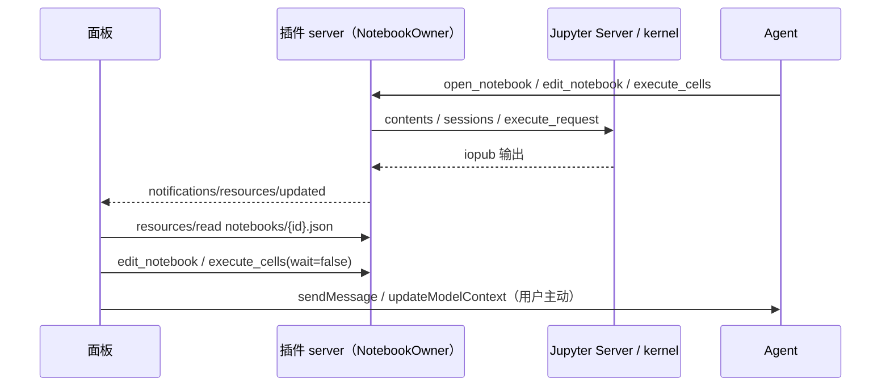

# Jupyter Notebook owner 与端口

插件 MCP server（Node）充当 notebook 前端：连接 Jupyter Server，持有打开的 notebook、执行队列与输出，经 Contents API 读写 `.ipynb`。页面和模型都只经它读写；页面不直连 Jupyter，不持有 token。

## 分层

- `jupyter/`：Jupyter Server REST（status、kernelspecs、sessions、kernels、contents）与 kernel WebSocket（旧版 JSON 帧，不协商子协议）。只认 `{baseUrl, token}`，不区分 server 来源。
- `servers/`：`ServerRegistry` 是连接唯一 owner。`attach(url, token)` 连接已有 server；`launch()` 找到装有 `jupyter_server` + `ipykernel` 的 Python，起 `python -m jupyter_server`（仅 `127.0.0.1`、随机端口、`JUPYTER_TOKEN`、root_dir = 工作区），就绪后同样 attach。`discover()` 读 Jupyter runtime 目录的 `jpserver-*.json`。只停止自己 launch 的 server；进程退出时一并停止。
- `domain/`：nbformat 规范化（补 cell id、source 归一为字符串）、编辑操作、输出归并（stream 合并、`clear_output(wait)`、`update_display_data`）、模型摘要。纯函数。
- `app/notebooks.ts`：`NotebookOwner` 是已打开 notebook 的唯一 owner：文档、revision、kernel session、执行、自动保存与冲突。
- `adapters/`：MCP 工具、资源与订阅。

## 一致性

- notebook id 由 `serverId + path` 派生，重开得到同一 id。session 级 `current` 是工具省略 `notebook` 时的默认值。
- `revision` 只在内容（结构 / source / type）变化时加一；`version` 在任何可见变化时加一。每个 cell 自带 `revision`。
- `edit_notebook` 一批操作原子应用：任何一项失败则整批不生效。`update` 可带 cell 级 `expectedRevision`，整批可带 notebook 级 `expectedRevision`；冲突返回 `revision_conflict` 与当前状态，绝不覆盖。
- 保存：编辑后防抖经 Contents API 写回。写前比较 `last_modified`；文件被他人改过时进入 `conflict`，不覆盖，由 `save_notebook({ overwrite })` 或 `open_notebook({ reload })` 解决。打开 / 读取时若文件已变且本地无未保存修改，自动重载。
- 执行：每个 notebook 一个 Jupyter session（`POST /api/sessions`，按 path 复用已有 session，因此与 JupyterLab 共享 kernel）。execute_request 立即全部发往 kernel，由 kernel 排队；`stop_on_error` 让后续请求 `aborted`。cell 运行完成以 `execute_reply` 与同 parent 的 iopub `idle` 都到达为准。其他客户端的消息只用于 kernel 状态。
- 中断 / 重启走 REST；重启后在途 cell 记为 `aborted`。
- 归属：cell 的 `edit = { by, at }` 记录最近一次 source / type 修改，`run.by` 记录谁请求了运行。模型工具记为 `agent`，面板专用工具记为 `user`（宿主不把页面调用的 `_meta` 传给 server，所以用两个只对页面可见的工具区分）。`run.seq` 是 notebook 内递增的排队序号（面板据此显示排队先后），同一次运行请求的 cell 共享 `run.batch`（面板据此显示“正在运行 3 / 5”）。只在内存中，不写入文件。
- 资源只给页面完整数据；工具结果的 `structuredContent` 只带 `NotebookRef` 等小对象（宿主会把它附给模型）。模型通过文本摘要与图片内容块读取输出。

## 工具

| 工具 | 调用方 | 说明 |
| --- | --- | --- |
| `list_servers` | model, app | 已连接与已发现的 server（不含 token） |
| `connect_server` | model, app | `url`（可带 `?token=`）、`token?`；已发现的本机 server 无需 token |
| `start_server` | model, app | `python?`、`useUv?`；已在运行则直接返回 |
| `stop_server` | model, app | 仅限 launched |
| `list_notebooks` | model, app | 列出 server 某目录下的 `.ipynb` 与子目录 |
| `open_notebook` | model, app | `path`、`server?`、`create?`、`reload?`、`kernel?`；打开侧栏 |
| `read_notebook` | model, app | 文本摘要；`cellIds?`、`includeOutputs?`、`maxOutputChars?` |
| `edit_notebook` | model, app | 操作批次，见 `EditOperation` |
| `execute_cells` | model, app | `cellIds?` 或 `all`；`wait`（模型默认等待，页面传 false）；超时返回“仍在运行” |
| `interrupt_kernel` / `restart_kernel` | model, app | 重启可选 `runAll` |
| `list_kernelspecs` / `set_kernel` | model, app | 切换 notebook 的 kernel |
| `save_notebook` | model, app | `overwrite?` 解决保存冲突 |
| `close_notebook` | app | 页面关闭 notebook |
| `panel_edit_notebook` / `panel_execute_cells` | app | 面板里用户的编辑与运行；与模型工具相同，但记为用户所做（`panel_execute_cells` 可带 `restart`） |

所有工具带 `_meta.ui = { resourceUri: PANEL_URI, surface: "jupyter-notebook" }`。`open_notebook` 声明自动打开侧栏。页面只使用会改变状态的工具；读取一律走资源（不触发审批）。

## 资源

- `ui://jupyter-notebook/panel.html`：页面，单文件 HTML。
- `ui://jupyter-notebook/state.json`：`SessionState`，可订阅。
- `ui://jupyter-notebook/notebooks/{id}.json`：`NotebookDoc`，可订阅；运行中节流约 100 ms 通知一次。超出 `LIMITS.resourceBytes` 时省略最大的输出并计数。

## 页面通信

页面只使用官方 MCP Apps SDK，一个 App、一次连接，处理器先于连接注册。页面状态全部可由资源重建（宿主会销毁离屏 5 分钟的页面）。

## 安全

- token 不出现在工具结果、资源、日志或页面中；launched server 只绑定 `127.0.0.1`。
- 不自动安装任何东西；缺少依赖时返回 `jupyter_not_installed` 与安装建议。`useUv` 是显式选项。
- HTML / SVG / Markdown 输出在页面经 DOMPurify 清洗后渲染，不执行输出中的脚本。
